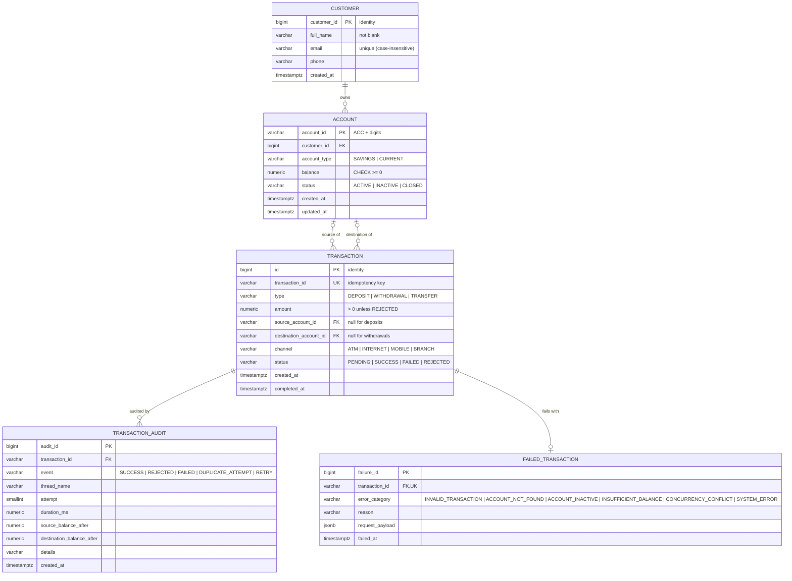

# ER Diagram

Source of truth: [`db/migration/V1__create_schema.sql`](../db/migration/V1__create_schema.sql).

## Key constraints

| Constraint | Protects against |
|---|---|
| `chk_account_balance_non_neg` | A negative balance can never be committed, even if application logic is wrong. |
| `uq_transaction_transaction_id` | Two requests with the same id (even arriving concurrently) can never both be recorded, so money moves at most once. |
| `chk_transaction_success_shape` | A successful deposit/withdrawal/transfer always references exactly the accounts its type needs; no self-transfers. |
| `chk_transaction_amount` | Only rejected rows may hold a non-positive amount (stored as received, for an honest audit). |
| `chk_transaction_completed_at` | A row is finished (`SUCCESS`/`FAILED`/`REJECTED`) if and only if it has a completion time. |
| `uq_failed_transaction_txn` | One final failure record per transaction. |

## Indexes and the queries they serve

| Index | Serves |
|---|---|
| `idx_account_customer_id` | FK lookups; customer → accounts (report 5). |
| `idx_transaction_source_created` (partial) | History / counts per source account (reports 1, 4, 5). |
| `idx_transaction_destination_created` (partial) | History / counts per destination account (reports 1, 4, 5). |
| `idx_transaction_created_type` (covering) | Daily amount by type over a date range (report 3). |
| `idx_failed_transaction_category` | Failures grouped by reason (report 2). |
| `idx_transaction_audit_txn_created` | Full audit trail of one transaction, in order. |

EXPLAIN ANALYZE evidence for these will be added in `db/explain/` during the performance phase.
